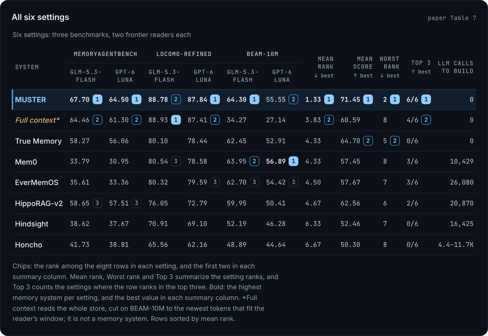

<h1 align="center">
  <a href="https://saintmachines.github.io/MUSTER/"><picture>
    <source media="(max-width: 1011px)" srcset="docs/assets/readme_page/hero_phone.png">
    <source media="(min-width: 1012px)" srcset="docs/assets/readme_page/hero.png">
    
  </picture></a>
</h1>

<p align="center"><b>MUSTER</b> detects the structure a store already records, then matches retrieval and context assembly to it. No language model builds or grows the memory.</p>

<p align="center">
  <a href="https://saintmachines.github.io/MUSTER/"><b>Project page</b></a> ·
  <a href="paper/MUSTER.pdf"><b>Paper (PDF)</b></a> ·
  <a href="https://pypi.org/project/muster-memory/"><b>PyPI</b></a> ·
  <a href="https://saintmachines.github.io/MUSTER/try/"><b>Inspect a store in your browser</b></a> ·
  <a href="https://huggingface.co/datasets/saintmachines/MUSTER-eval"><b>Evaluation data</b></a> ·
  <a href="#cite"><b>Cite</b></a>
</p>

<p align="center">
  <a href="https://pypi.org/project/muster-memory/"></a>
  <a href="LICENSE"></a>
  <a href="pyproject.toml"></a>
  <a href="gate/"></a>
</p>

```bash
pip install "muster-memory[models,mcp]"
```

## <picture><source media="(prefers-color-scheme: dark)" srcset="docs/assets/readme/h2_01_dark.svg"></picture>Results

### The highest mean score across six settings.

Two frontier readers, GLM-5.3-Flash and GPT-6 Luna, read every system's
context on three benchmarks of different character, each scored by its own official judge. MemoryAgentBench has fourteen
stores from numbered assertion logs to a detective novel, LoCoMo-Refined has long conversations, and BEAM-10M has
conversations of 10M tokens. In each setting every system has the same reader, answer prompt and judge.

<p align="center">
  <picture>
    <source media="(max-width: 1011px)" srcset="docs/assets/readme_page/results_phone.png">
    
  </picture>
</p>

<sub>\*Full context reads the whole store as is, and on BEAM-10M the newest 850K tokens that fit the reader's window. It is
not a memory system.</sub>

MUSTER ranks first or second in all six settings. On MemoryAgentBench and LoCoMo-Refined it is above every other memory
system at both readers (p < 0.001), and it reads 5K to 20K tokens per question, 1/34 of the full context's read cost.
Results at each benchmark's own reader are in [Detailed results](#detailed-results).

<details>
<summary>The table as text</summary>

<!-- BEGIN headline:overview -->
| System | MAB<br>GLM | MAB<br>Luna | LoCoMo-Ref.<br>GLM | LoCoMo-Ref.<br>Luna | BEAM-10M<br>GLM | BEAM-10M<br>Luna | Mean<br>rank | Mean<br>score | Worst<br>rank | Top 3<br>(of 6) | LLM calls<br>10M build |
|:--|--:|--:|--:|--:|--:|--:|--:|--:|--:|--:|--:|
| **MUSTER** | **67.70** | **64.50** | **88.78** | **87.84** | **64.30** | **55.55** | **1.33** | **71.45** | **2** | **6** | **0** |
| Full&nbsp;context\* | 64.46 | 61.30 | 88.93 | 87.41 | 34.27 | 27.14 | 3.83 | 60.59 | 8 | 4 | 0 |
| True&nbsp;Memory | 58.27 | 56.06 | 80.10 | 78.44 | 62.45 | 52.91 | 4.33 | 64.70 | 5 | 0 | 0 |
| Mem0 | 33.79 | 30.95 | 80.54 | 78.58 | 63.95 | 56.89 | 4.33 | 57.45 | 8 | 3 | 10,429 |
| EverMemOS | 35.61 | 33.36 | 80.32 | 79.59 | 62.70 | 54.42 | 4.50 | 57.67 | 7 | 3 | 26,080 |
| HippoRAG‑v2 | 58.65 | 57.51 | 76.05 | 72.79 | 59.95 | 50.41 | 4.67 | 62.56 | 6 | 2 | 20,870 |
| Hindsight | 38.62 | 37.67 | 70.91 | 69.10 | 52.19 | 46.28 | 6.33 | 52.46 | 7 | 0 | 16,425 |
| Honcho | 41.73 | 38.81 | 65.56 | 62.16 | 48.89 | 44.64 | 6.67 | 50.30 | 8 | 0 | 4.4–11.7K |
<!-- END headline:overview -->

<sub>Bold: MUSTER. LLM calls: calls to build memory for one 10M-token conversation.</sub>

</details>

## <picture><source media="(prefers-color-scheme: dark)" srcset="docs/assets/readme/h2_02_dark.svg"></picture>Cost

### 77 s to build. 1/34 of the read cost.

Memory usually costs one of two ways. An LLM extracts it when you write, or
the model reads everything when you answer. MUSTER stores the text as is and fits its read to the structure, with 0 LLM
calls to build and 5K to 20K tokens per question.

<p align="center">
  <picture>
    <source media="(max-width: 1011px)" srcset="docs/assets/readme_page/cost_phone.png">
    <source media="(min-width: 1012px)" srcset="docs/assets/readme_page/cost.png">
    
  </picture>
</p>

<details>
<summary>As a table, with how each cost is counted</summary>

<!-- BEGIN headline:build -->
| System | LLM calls | Build time | LLM cost | Notes |
|:--|--:|--:|--:|:--|
| EverMemOS | 26,080 | 32.7 h | ≥ $3.19 | build time: mean per conversation, all ten built at once; cost: GPT-OSS-120B (cheapest OpenRouter route, Near AI), 106.3M input tokens at $0.03/M, output not recorded |
| HippoRAG-v2 | 20,870 | 1.3 h | $1.49 | build time: mean per conversation; cost: GPT-OSS-120B (cheapest OpenRouter route, Near AI), 30.12M input tokens at $0.03/M, 3.937M output tokens at $0.15/M |
| Hindsight | 16,425 | 3.0 h | ≥ $1.97 | build time: mean per conversation; cost: GPT-OSS-120B (cheapest OpenRouter route, Near AI), 65.5M input tokens at $0.03/M, output not recorded |
| Honcho | 4,441–11,700 | 7.8 h | $1.41 | build time: with queue drain; cost: Honcho (honcho.dev list price for ingestion), 0.705M input tokens at $2.00/M; in its own BEAM setup Honcho reasons over the user's turns, 7,051,753 tokens over the ten conversations, 6.5% of the 108.1M sent |
| Mem0 | 10,429 | 13.0 h | ≥ $15.15 | cost: GPT-4o-mini (OpenAI list price), 101.0M input tokens at $0.15/M, output not recorded |
| True Memory | 0 | 39 min | $0 | no generative call; built on one RTX PRO 6000 |
| **MUSTER** | 0 | 77 s | $0 | no generative call; built on one GPU with bge-m3 in fp16 |
| Full context | 0 | nothing to build | $0 | reads everything for every question, 849K tokens per BEAM-10M question |
<!-- END headline:build -->

</details>

## <picture><source media="(prefers-color-scheme: dark)" srcset="docs/assets/readme/h2_03_dark.svg"></picture>How it works

### Detect the structure. Retrieve by it. Assemble in order.

Most stores already record their structure. Logs number
their lines, example banks separate their records, conversations keep their order. MUSTER measures that structure
instead of paying an LLM to rebuild it, and fits the two steps that decide an answer to it, what to retrieve and in what
order to show it.

<p align="center">
  <picture>
    <source media="(max-width: 1011px)" srcset="docs/assets/readme_page/steps_phone.png">
    
  </picture>
</p>

1. **Detect the structure.** Two counts over the bytes, the share of numbered lines and the share of text in records
   short enough to keep whole, set each store's unit, parent and order. No model, no labels, no candidate runs.
   Fourteen stores take three seconds.
2. **Match retrieval to it.** Dense search, BM25 and a parent graph each keep a floor of slots, set by the structure.
   On a numbered log the parent graph takes most of them, elsewhere the three are balanced. One rerank fills the rest.
   *Parent graph first on numbered logs adds 6.0 on selective forgetting.*
3. **Assemble in its order.** The context is shown in stored order, one block per parent. Where the store numbers its
   records, only the newest version of each fact is shown, at read time, so nothing is deleted. *Fact consolidation,
   one store, scores 92 in the recorded order, 64 with none and 59 shuffled.*

<p align="center">
  <picture>
    <source media="(max-width: 1011px)" srcset="docs/assets/readme_page/lead_phone.png">
    <source media="(min-width: 1012px)" srcset="docs/assets/readme_page/lead.png">
    
  </picture>
</p>

With no detection, on the benchmark's own chunks, retrieval and assembly already score 50.3, above every other
retrieval and memory system on the benchmark (best 43.6). Matched to each store's detected structure they reach 57.5.
Units, parents and order add 5.7, the retrieval mix 1.5. A query costs one embedding, one rerank and one reader call,
and nothing is written back.

<details>
<summary>The bars as a table</summary>

<!-- BEGIN headline:lead -->
| | MemoryAgentBench Overall | What it is |
|:--|--:|:--|
| BM25 | 41.5 | sparse retrieval, reported by MemoryAgentBench |
| Full context (128K window) | 42.2 | GPT-4o-mini reads the whole store; the oldest chunks drop out past its window |
| True Memory | 43.6 | the strongest other retrieval or memory system; it also builds with no LLM call |
| Retrieval + assembly, no detection | 50.3 | detection off: the benchmark's own chunks, balanced floors and one rerank, assembled in stored order |
| + detection: units, parents, order | 56.0 | detection on: unit, parent and order from each store's structure; floors still balanced |
| **+ retrieval mix matched (MUSTER)** | 57.5 | the shipped system: the floors also follow the structure, parent graph first on numbered logs, balanced elsewhere |
<!-- END headline:lead -->

</details>

<details>
<summary>The two statistics and the rule, verbatim</summary>

| Statistic | Definition | Question it answers |
|---|---|---|
| **serial fraction** | share of non-empty lines that open with `<integer>. <body>` | does the store count, so that an order exists to resolve by? |
| **record share** | token-weighted share of blank-line records no longer than the reference scale *c* | is the store made of records, so that a finer cut never splits one? |

> If serial ≥ 0.80, the unit is the record with its serial stripped, the parent is the record's normalised slot, and the order
> is the serial. Otherwise the unit is the chunk size the benchmark prescribes, cut so a record is never split when
> record share ≥ 0.90 and refined one documented step under the same condition, the parent is eight times the unit, halved
> until at least ten parents remain, and no order is claimed.

Three constants appear: the refinement step moves between the only two chunk sizes MemoryAgentBench
itself uses (512 and 4096), the parent multiplier of eight is their ratio, and the floor of ten parents is the retrieval
budget. A store where serial fires takes the parent-priority retrieval arm, every other store the balanced one. Prose
that keeps the 4,096-token unit is searched at 1,024 tokens with four times as many units, so the token budget does not
change.

The library recognizes serials written as `Step 12:`, `#12` or `(12)` as numbered logs, when a log's short lines count
up one at a time. [docs/library](docs/library/README.md) gives the exact check and the additional native slot and
value-walk rules, which apply only to `12.` logs.

</details>

<p align="center">
  <picture>
    <source media="(max-width: 1011px)" srcset="docs/assets/readme_page/film_phone.gif">
    
  </picture>
</p>

<p align="center"><sub>One rule on two real stores, replayed on a CPU. The contexts are byte-identical to the published runs.</sub></p>

## <picture><source media="(prefers-color-scheme: dark)" srcset="docs/assets/readme/h2_04_dark.svg"></picture>Quick start

The Python distribution is `muster-memory` and imports as `muster`. The command below adds local retrieval models and the MCP
server (in a clone of this repository, `pip install ".[models,mcp]"`).
For structure inspection alone, use `pip install muster-memory`.

[Inspect a store in your browser](https://saintmachines.github.io/MUSTER/try/): paste text to see its statistics and selected configuration. The preview runs locally in the browser and uses no API key.

```bash
pip install "muster-memory[models,mcp]"
```

```python
import muster

store = muster.Store.open("agent.muster")                   # one file; survives restarts
store.add({"speaker": "user", "text": "I moved to Lisbon in May.", "time": "2026-05-02"})
print(store.context("Where does the user live now?").text)   # the stored passages, verbatim, in stored order
```

The store measures its own structure as it grows (`muster.explain(store.head().plan)` shows what it chose), keeps every
word, and makes no LLM call to build or grow.

* **Claude, Cursor or any MCP client:** `muster mcp --store agent.muster`
* **Any app or robot over HTTP:** `muster http --store agent.muster` (`POST /v1/add`, `/v1/context`)
* **Agent frameworks:** OpenAI Agents SDK, LangChain and LangGraph through `muster.integrations`
  ([docs/library](docs/library/README.md))

[Connect it to your app](docs/library/apps.md): choose an interface, configure an
MCP host, send HTTP requests, or put memory around the model call you already use.
The guide links a runnable wiring demo and the three framework adapters.

To see what the rule decides for a store of your own, with no model or key (the store never leaves the machine):

```bash
pip install muster-memory && muster derive path/to/store.txt
```

What it prints for BEAM, conversation 0, saved as text:

```text
MUSTER  beam_conv0.txt  115,630 tokens
  store      record store
  units      512 tokens, records whole
  parents    4,096 tokens, 28 of them
  order      none: all versions kept
  retrieval  balanced, 3 channels
```

## <picture><source media="(prefers-color-scheme: dark)" srcset="docs/assets/readme/h2_05_dark.svg"></picture>Detailed results

<details>
<summary><b>MemoryAgentBench</b> (GPT-4o-mini reader, the benchmark's own protocol)</summary>

Fourteen stores across four competencies: accurate retrieval (AR), test-time learning (TTL), long-range understanding (LRU)
and selective forgetting (SF, the two FactConsolidation cells). "All" averages the four competencies.

| System | AR | TTL | LRU | SF | **All** |
|---|---|---|---|---|---|
| GPT-5-mini, whole context (400K window) | 74.4 | 48.6 | 66.2 | 53.0 | 60.6 |
| GPT-4o, whole context (128K window) | 58.1 | 50.0 | 54.9 | 32.5 | 48.8 |
| BM25 (reported by the benchmark) | 60.5 | 44.5 | 35.6 | 25.5 | 41.5 |
| HippoRAG-v2 (reported by the benchmark) | 65.1 | 35.8 | 36.2 | 29.5 | 41.6 |
| Mem0 2.1.0, model-written memories | 49.9 | 9.0 | 39.1 | 9.0 | 26.7 |
| Mem0 2.1.0, raw chunks, Mem0's search | 46.3 | 39.0 | 41.8 | 28.5 | 38.9 |
| Honcho | 46.7 | 23.8 | 45.7 | 24.0 | 35.0 |
| Hindsight 0.10.3 | 61.8 | 9.4 | 28.4 | 26.0 | 31.4 |
| EverMemOS (GPT-OSS-120B writer) | 36.5 | 19.7 | 24.7 | 11.5 | 23.1 |
| True Memory | 63.8 | 43.5 | 41.2 | 26.0 | 43.6 |
| **MUSTER** | **73.8** | **47.5** | **44.2** | **64.5** | **57.5** |

MUSTER leads every retrieval and memory system in the table on the total (57.5 against True Memory's 43.6) and on three of the
four competencies. Against
True Memory, which also writes no model-made memory, the gap is widest where detection acts: selective forgetting, 64.5
against 26.0. On FactConsolidation multi-hop MUSTER scores 37.0, the highest value in the full table, in a column where
twenty-two of the twenty-three other rows are in single digits. At the same reader it beats the whole store read in context
by 14.0 points at GPT-4.1-mini and 4.1 at GPT-5-mini (64.7 against 60.6).

*Limits:* the whole-context rows read the store through 400K and 128K windows, oldest chunks evicted; rows marked as reported by the benchmark were not re-run here.

</details>

<details>
<summary><b>LoCoMo</b> (1,540 questions; GPT-4.1-mini reader, GPT-4o-mini judge)</summary>

LoCoMo prescribes no answer prompt and the two in use move scores by 6.5 to 11.9 points on the same contexts, so every
store is read under both. "Before answering" counts the language-model calls and input each system spends over the ten
conversations before the first question.

| System | Mem0's prompt | EverMemOS's prompt | Reader context | LM calls | LM input |
|---|---|---|---|---|---|
| Mem0 2.1.0 | 80.50 | 89.44 | 4.7K | 5,882 | 50.3M |
| Honcho | 67.34 | 77.62 | 5.2K | n/o | ≥0.18M |
| Hindsight 0.10.3 | 73.48 | 85.35 | 5.0K | 602 | 2.2M |
| EverMemOS | 83.87 | 93.05 | 2.4K | 9,398 | 12.9M |
| Full conversation | 82.06 | 93.44 | 31.1K | 0 | 0 |
| True Memory | 81.93 | 90.58 | 4.9K | 0 (one HyDE expansion per question) | 0 |
| **MUSTER, 5 units** | **85.74** | **92.25** | **2.5K** | **0** | **0** |
| **MUSTER, 10 units** | **86.04** | **93.46** | **5.0K** | **0** | **0** |

Our EverMemOS run reproduces its reported 93.05. Under its own answer prompt MUSTER scores 93.46 at ten units; under Mem0's
prompt it leads every store by 2.2 to 18.7 points (86.04 against EverMemOS's 83.87 and Honcho's 67.34).

*Limits:* Honcho's language-model calls are not observable (n/o); Mem0's and True Memory's lists are cut to MUSTER's context at ten units.

</details>

<details>
<summary><b>BEAM, 100K to 10M tokens</b> (GLM-5.3-Flash reader, BEAM's official judge)</summary>

The rule set on MemoryAgentBench runs on BEAM unchanged. Score is the ten-category macro of the official rubric judge;
"build" is the cost of making memory for one 10M-token conversation, and build time is for one conversation at each
scale (EverMemOS: all conversations of a scale in one run).

| System | 100K | 1M | 10M | Mean | Context | LM calls | LM input | Build time 100K / 1M / 10M |
|---|---|---|---|---|---|---|---|---|
| Mem0 2.1.0 | 75.5 | 72.3 | 62.3 | 70.0 | 8.2K | 10,429 | ≈101M | 11 m / 77 m / 13 h |
| Mem0 2.1.0, 19.5K | 75.5 | 73.1 | 63.9 | 70.8 | 19.5K | 10,429 | ≈101M | 11 m / 77 m / 13 h |
| Honcho | 67.1 | 60.7 | 48.9 | 58.9 | 20.7K | 4.4–11.7K | ≥10.8M | 7 m / 28 m / 7.8 h |
| Hindsight 0.10.3 | 66.4 | 67.2 | 52.2 | 61.9 | 8.4K | 16,425 | 65.5M | 49 m / 30 m / 3.0 h |
| EverMemOS | 72.0 | 69.4 | 60.6 | 67.3 | 4.5K | 26.1K | 106M | 43 m / 7.7 h / 32.7 h |
| EverMemOS, 19.5K | 76.3 | 73.1 | 62.7 | 70.7 | 19.5K | 26.1K | 106M | 43 m / 7.7 h / 32.7 h |
| True Memory, 9.7K | 75.4 | 72.1 | 61.4 | 69.6 | 9.7K | 0 | 0 | 8 s / 3.3 m / 39 m |
| True Memory, 19.5K | 78.1 | 74.6 | 62.4 | 71.7 | 19.5K | 0 | 0 | 8 s / 3.3 m / 39 m |
| **MUSTER, 20 units** | **75.0** | **72.4** | **62.7** | **70.0** | **9.7K** | **0** | **0** | **1 s / 7 s / 77 s** |
| **MUSTER, 40 units** | **76.1** | **73.4** | **64.3** | **71.3** | **19.5K** | **0** | **0** | **1 s / 7 s / 77 s** |

With the open-weight Qwen3.5-9B as reader, MUSTER's three-scale mean is 60.3 under our answer prompt and 44.2 under BEAM's
own, first on both, against 59.9 and 41.8 for EverMemOS and 59.8 and 42.6 for True Memory. True Memory's released worker takes 39 minutes
to build the 10M conversation where MUSTER takes 77 seconds.

*Limits:* 400, 700 and 200 questions over 20, 35 and 10 conversations at 100K, 1M and 10M; the Qwen3.5-9B reader and BEAM's own answer prompt are in the paper's appendix.

</details>

## <picture><source media="(prefers-color-scheme: dark)" srcset="docs/assets/readme/h2_06_dark.svg"></picture>Reproduce

<details>
<summary>The reproduction gate, the data and the pinned code</summary>

Re-scoring uses the [base evaluation artifact](data/eval_v1/README.md) and its
[v2 supplement](data/eval_v2/README.md). Together they provide saved BEAM answers and judgments, Honcho query/context
records, source-based ingestion reconstruction, SHA-256 manifests and offline verification instructions.
The large result files are distributed as release assets.

```bash
muster verify cuts --data data_root
muster verify contexts --data data_root
```

The first command checks the rule's cuts store by store; the second checks the
library's contexts question by question against the published runs. Replace
`data_root` with your downloaded evaluation data folder.

| Check | Result | Evidence |
|---|---|---|
| Detection on the fourteen MemoryAgentBench stores | twelve exact; the two FactConsolidation stores take the numbered-log branch | [gate/stage0_derive.md](gate/stage0_derive.md) |
| Rendered contexts, BEAM 100K, 1M and 10M and LoCoMo | 14 of 14 files sha256-identical | [gate/stage0_tier0.md](gate/stage0_tier0.md) |
| Every context the MemoryAgentBench board read | 5,439 of 5,439 per-question hashes equal | [gate/stage0d_render.md](gate/stage0d_render.md) |
| CPU retrieval replay, BEAM-100K at 20 units | 400 of 400 contexts byte-identical | [gate/stage1_beam100k.md](gate/stage1_beam100k.md) |
| MemoryAgentBench board, re-scored from its per-cell results | 57.52 / 60.92 / 64.71, all 45 values equal | [gate/rescore_mab.md](gate/rescore_mab.md) |
| BEAM main table, re-scored from its judge files | every score equal | [gate/rescore_beam.md](gate/rescore_beam.md) |

Data, pinned versions and the two checks are in [docs/library/verify.md](docs/library/verify.md). `harness/` is the code
that produced every table, pinned file by file in `MANIFEST.sha256`; the benchmarks' templates, judge prompts and scorers
are fetched from their own repositories at pinned commits (`scripts/fetch_mab_repo.sh`, `scripts/fetch_beam_repo.sh`),
never redistributed. Readers run through one pinned provider per model, and a reader-swap bundle pins every context by
sha256, so a new reader reads byte-identical contexts. The numbers at the top of this page live in
[docs/data/headline.json](docs/data/headline.json); `python tools/make_readme.py` regenerates every table
above from it, and `node tools/make_readme_media.js` renders the pictures from the project page.

</details>

## <picture><source media="(prefers-color-scheme: dark)" srcset="docs/assets/readme/h2_07_dark.svg"></picture>FAQ

<details>
<summary>Five questions people ask first</summary>

**Does it need a language model at all?** Not before the first query. Detection, unit cutting, embedding and BM25 are
the whole write path. A query uses one reader call, like any retrieval system.

**Which stores does the rule recognise?** Anything a writing process produces: numbered logs, record-delimited banks
(conversations one turn per record, example banks one example per record) and prose. The rule names the branch it took,
so you can see why it chose a unit.

**What if my store already has Mem0 memories?** Keep them. Mem0's memories, one per line in write order, read as a
numbered store, and MUSTER reads them beside the conversation under the same rule.

**Which embedder and reranker?** `BAAI/bge-m3` and `BAAI/bge-reranker-v2-m3` by default, both local.

**Can I run it without a GPU?** Detection, yes, anywhere, in well under a second per store. The retrieval path embeds
the store once with bge-m3; a CPU-only configuration is part of the reproduction gate.

</details>

## <picture><source media="(prefers-color-scheme: dark)" srcset="docs/assets/readme/h2_08_dark.svg"></picture>Cite

```bibtex
@misc{muster2026,
  title  = {MUSTER: Top-Ranked, Self-Configuring Agent Memory That Knows a Log from a Novel and Retrieves Each by Its Structure},
  author = {Woosang Lim},
  year   = {2026}
}
```

GitHub's *Cite this repository* button reads [CITATION.cff](CITATION.cff).

## <picture><source media="(prefers-color-scheme: dark)" srcset="docs/assets/readme/h2_09_dark.svg"></picture>Paper, status, license

The paper is *MUSTER: Top-Ranked, Self-Configuring Agent Memory That Knows a Log from a Novel and Retrieves Each by Its Structure*; the PDF is in
[`paper/MUSTER.pdf`](paper/MUSTER.pdf). This is a research release. What was checked, and the evidence for each line,
is in [STATUS.md](STATUS.md).

The library is Apache-2.0. See [LICENSE](LICENSE) and [NOTICE](NOTICE). Benchmark content keeps its own license.
The evaluation releases include BEAM content under CC BY-SA 4.0 and LoCoMo and LoCoMo-Refined content under
CC BY-NC 4.0, with attribution and upstream notices in each bundle. The systems we compare against retain their own licenses.

<a href="https://saintmachines.ai"><picture><source media="(prefers-color-scheme: dark)" srcset="docs/assets/brand/saintmachines_lockup_white.svg"></picture></a>
